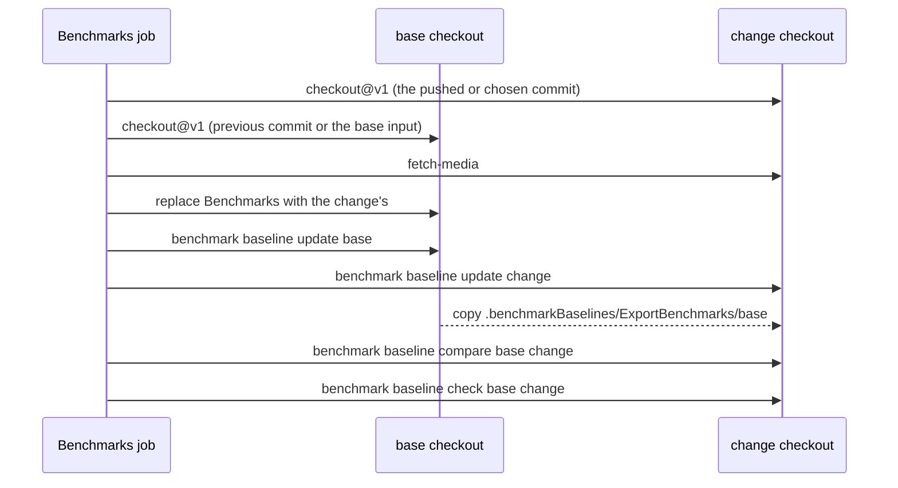

# Benchmarks

Benchmarks for SJSAssetExportSession, so a change that makes exports slower or hungrier shows up
before it ships. They're a separate package, built on [ordo-one/benchmark][benchmark], so the
library itself keeps zero dependencies.

[benchmark]: https://github.com/ordo-one/benchmark

## Running

```bash
cd Benchmarks
./fetch-media
swift package --disable-sandbox benchmark
```

`--disable-sandbox` is required. Inside SwiftPM's plugin sandbox the AAC encoder can't be set up,
so every export fails, `AVAssetExportSession`'s included.

To run some of the benchmarks, pass a regular expression that matches their whole names:

```bash
swift package --disable-sandbox benchmark --filter 'Fixture.*'
```

## Media

There are two sets of benchmarks:

- **Fixture** benchmarks export the clips checked in with the tests, in
  `Tests/SJSAssetExportSessionTests/Resources`. They run on a fresh clone.
- **Bundle** benchmarks export real iPhone clips that are too big to check in. `./fetch-media`
  downloads them (about 600 MB) into `~/Library/Caches/SJSAssetExportSession/benchmark-media-v1`
  and checks them against `media.sha256`. Without them the bundle benchmarks are skipped. Set
  `SJS_BENCHMARK_MEDIA_DIR` to keep them somewhere else.

| Clip | What it is |
| --- | --- |
| `hdr-hlg-4k60-portrait-spatial-audio.mov` | iPhone 4K60 HLG HEVC, rotated to portrait, with spatial audio, 15.7s |
| `hdr-hlg-4k60-landscape-spatial-audio.mov` | iPhone 4K60 HLG HEVC, landscape, with spatial audio, 11.3s |
| `sdr-hevc-1080p30-41s.mov` | iPhone 1080p30 SDR HEVC, 40.9s |
| `sdr-h264-1080p60-mono-audio.mov` | iPhone 1080p60 H.264 with mono audio, 26.5s |
| `sdr-h264-1080p60-mono-audio-113s.mov` | iPhone 1080p60 H.264 with mono audio, 113s, for memory growth over a long export |
| `live-photo-hevc-lpcm-audio.mov` | Live Photo video, HEVC with uncompressed audio, 2.8s |

The clips are hosted as a [generic package on git.samhuri.net][media]. To change them, put the
new set in a folder, bump the version in both `fetch-media` and `BenchmarkMedia.bundleVersion`,
regenerate the manifest with `shasum -a 256 * > media.sha256` in that folder, and upload each
clip to the new version:

```bash
curl --fail --user sjs:<token> --upload-file <clip> \
  https://git.samhuri.net/api/packages/sjs/generic/sjs-asset-export-session-benchmark-media/<version>/<clip>
```

[media]: https://git.samhuri.net/sjs/-/packages

## What's measured

| Metric | Fails a comparison when the median is |
| --- | --- |
| CPU time | more than 10% higher |
| Peak resident memory | more than 15% higher |
| Wall-clock time | never, it's only reported |

After each export a benchmark checks that the output's duration and frame count match the source,
or the requested frame rate, within 2%. An export can't get faster by dropping frames.

The `AVAssetExportSession` benchmarks export the same clips with Apple's exporter, to compare the
library against on the same machine.

Allocation counts aren't measured. The benchmark package counts them with a malloc interposer
that crashes AudioToolbox's offline mixer, which the library uses to mix audio, so
`Package.swift` turns the interposer off.

## Comparing a change

Save a baseline before the change and one after, then check one against the other:

```bash
swift package --disable-sandbox --allow-writing-to-package-directory benchmark baseline update main
# Switch to the change.
swift package --disable-sandbox --allow-writing-to-package-directory benchmark baseline update change
swift package benchmark baseline check main change
```

The check fails when something regressed past the thresholds above. It also fails when the change
only improved things, and says so with "is BETTER than". Baselines are saved in
`.benchmarkBaselines`, which is ignored.

The Benchmarks workflow in `.forgejo/workflows/benchmarks.yml` does the same on the CI Mac. It
runs on pushes to main that touch the library or the benchmarks, comparing with the previous
commit, and can be run by hand on any branch to compare it with main or another ref. Both runs use
the newer commit's benchmarks, so a base from before a benchmark existed is still measured with
it.



The exports can fail with AVFoundation error -11800 when two encode on the same Mac at once, so
don't run the benchmarks alongside the tests.
