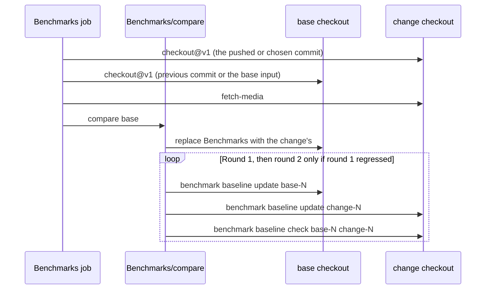

# Benchmarks

Benchmarks for SJSAssetExportSession, so a change that makes exports slower or hungrier shows up
before it ships. They're a separate package, built on [ordo-one/benchmark][benchmark], so the
library itself keeps zero dependencies.

[benchmark]: https://github.com/ordo-one/benchmark

## Running

```bash
cd Benchmarks
./fetch-media
swift package --disable-sandbox benchmark
```

`--disable-sandbox` is required. Inside SwiftPM's plugin sandbox the AAC encoder can't be set up,
so every export fails, `AVAssetExportSession`'s included.

To run some of the benchmarks, pass a regular expression that matches their whole names:

```bash
swift package --disable-sandbox benchmark --filter 'Fixture.*'
```

## Media

There are two sets of benchmarks:

- **Fixture** benchmarks export the clips checked in with the tests, in
  `Tests/SJSAssetExportSessionTests/Resources`. They run on a fresh clone.
- **Bundle** benchmarks export real iPhone clips that are too big to check in. `./fetch-media`
  downloads them (about 600 MB) into `~/Library/Caches/SJSAssetExportSession/benchmark-media-v1`
  and checks them against `media.sha256`. Without them the bundle benchmarks are skipped. Set
  `SJS_BENCHMARK_MEDIA_DIR` to keep them somewhere else.

| Clip | What it is |
| --- | --- |
| `hdr-hlg-4k60-portrait-spatial-audio.mov` | iPhone 4K60 HLG HEVC, rotated to portrait, with spatial audio, 15.7s |
| `hdr-hlg-4k60-landscape-spatial-audio.mov` | iPhone 4K60 HLG HEVC, landscape, with spatial audio, 11.3s |
| `sdr-hevc-1080p30-41s.mov` | iPhone 1080p30 SDR HEVC, 40.9s |
| `sdr-h264-1080p60-mono-audio.mov` | iPhone 1080p60 H.264 with mono audio, 26.5s |
| `sdr-h264-1080p60-mono-audio-113s.mov` | iPhone 1080p60 H.264 with mono audio, 113s, for memory growth over a long export |
| `live-photo-hevc-lpcm-audio.mov` | Live Photo video, HEVC with uncompressed audio, 2.8s |

The clips are hosted as a [generic package on git.samhuri.net][media]. To change them, put the
new set in a folder, bump the version in both `fetch-media` and `BenchmarkMedia.bundleVersion`,
regenerate the manifest with `shasum -a 256 * > media.sha256` in that folder, and upload each
clip to the new version:

```bash
curl --fail --user sjs:<token> --upload-file <clip> \
  https://git.samhuri.net/api/packages/sjs/generic/sjs-asset-export-session-benchmark-media/<version>/<clip>
```

[media]: https://git.samhuri.net/sjs/-/packages

## What's measured

| Metric | Fails a comparison when the median is |
| --- | --- |
| Instructions | more than 20% higher |
| Peak resident memory | more than 25% higher |
| Wall-clock time | never, it's only reported |
| CPU time | never, it's only reported |

Instructions are the process's retired instruction count, from `rusage`. Timings depend on what
else the machine is doing and instruction counts mostly don't: on a busy machine, two runs of the
same code differed by more than 50% in both CPU time and wall-clock time, while instructions
stayed within 11% and peak memory within 17%.

After each export a benchmark checks that the output's duration and frame count match the source,
or the requested frame rate, within 2%. An export can't get faster by dropping frames.

The `AVAssetExportSession` benchmarks export the same clips with Apple's exporter, to compare the
library against on the same machine.

Allocation counts aren't measured. The benchmark package counts them with a malloc interposer
that crashes AudioToolbox's offline mixer, which the library uses to mix audio, so
`Package.swift` turns the interposer off.

## Comparing a change

Check out the base to compare with in another directory, then run `compare` from the change:

```bash
git worktree add ../base main
Benchmarks/compare ../base
```

It replaces the base's `Benchmarks` directory with this one, so both are measured with the same
benchmarks, and benchmarks the base and then the change. When the change regressed past the
thresholds above, it benchmarks both again and fails only if the second pair regressed too, so a
burst of load during one run doesn't fail the comparison. Options after the base are passed to
the benchmarks, such as `--filter 'Fixture.*'`. Baselines are saved in `.benchmarkBaselines`,
which is ignored.

The Benchmarks workflow in `.forgejo/workflows/benchmarks.yml` runs `compare` on a CI Mac. It runs
on pushes to main that touch the library or the benchmarks, comparing with the previous commit,
and can be run by hand on any branch to compare it with main or another ref.



`compare` takes the same lock as the tests in CI, because exports fail with AVFoundation error
-11800 when two encode on the same Mac at once. Running `swift package benchmark` yourself doesn't,
so don't run it alongside the tests.
